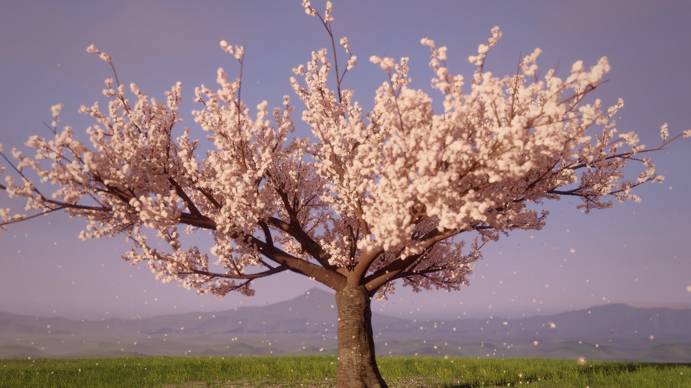
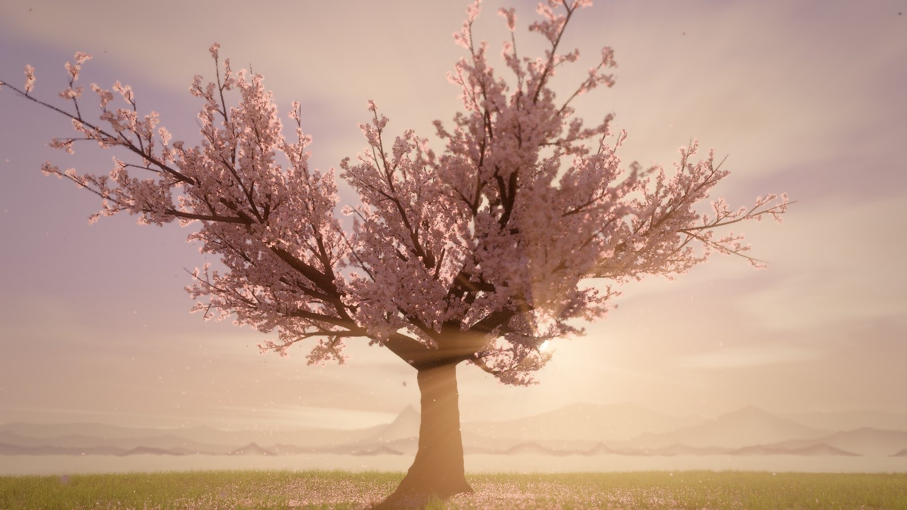
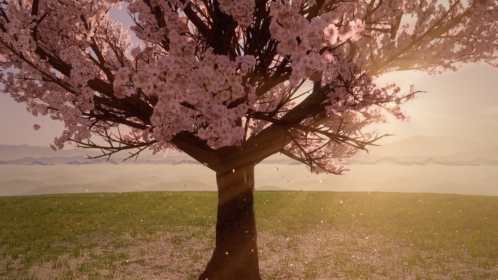
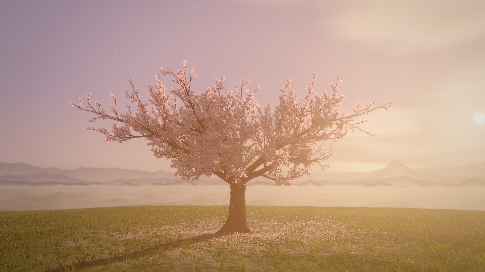

# Yūzakura · 夕桜

*Cherry blossoms at dusk.* A Somei Yoshino cherry in full bloom on a grassy knoll at
golden hour, grown and rendered in real time in the browser. Petals let go of the crown,
ride the gusts that sway the branches and settle on the meadow, while the camera drifts
slowly around the tree.



| | |
|---|---|
|  |  |
|  | |

## Running it

The scene is plain ES modules with no build step. Serve the folder with any static
server and open it in a browser with WebGL 2:

```sh
python3 -m http.server 8000
# then open http://localhost:8000
```

three.js (0.170.0) loads from jsDelivr through the import map in `index.html`. That is
the only dependency.

### Controls

| Input | Action |
|---|---|
| Drag | Look around the tree (the cinematic camera hands over to you) |
| Scroll / pinch | Move closer or further away |
| `C` or `Space` | Toggle the cinematic camera |
| `M` | Toggle the ambient sound |
| `H` | Hide or show the interface |

The cinematic camera resumes on its own after a few quiet seconds.

### URL options

| Parameter | Meaning |
|---|---|
| `?seed=23` | Grow a different tree. Every seed gives a new skeleton, crown and blossom layout |
| `?quality=low\|medium\|high` | Override the automatic quality choice |

Quality is picked from the GPU class, and the render scale then adapts to hold a smooth
frame rate.

## How it is made

Nothing in the scene comes from a stock primitive. Every mesh, texture pattern and
shader is generated by the code in `src/`.

**Tree skeleton** (`src/tree/skeleton.js`). A short leaning trunk forks into five spreading
scaffold limbs and a central leader. Each order of branches sprouts the next with
phyllotactic rotation. Growth is steered by smooth wander noise, photo- and gravitropism,
an outward spread bias and a lumpy dome-shaped crown envelope. Radii follow a pipe model,
with cross-section proportional to the wood downstream, and the trunk swells into a
knuckle at the fork. Seven surface roots arch out of the flare and dive under the turf.
Every node also carries hierarchical wind weights.

**Bark** (`src/tree/barkMesh.js`, `barkMaterial.js`). Branches are generalized cylinders
swept along Catmull-Rom curves with parallel-transport frames. Cross-sections are
sculpted per vertex with buttress lobes, base flare, gnarl, twisting ridges, collars where
limbs leave the parent and swollen bark around strong side branches. The shader paints
cylinder-space patterns: glossy mahogany young bark banded with horizontal lenticels, and
old bark broken into horizontally elongated plates (cellular noise) split by dark
crevices, with lichen and moss.

**Blossoms** (`src/tree/blossoms.js`, `blossomMaterial.js`). About 240,000 flowers grow in
clusters of three to six on drooping pedicels along the fine twigs. Each flower has its
own openness (tight crimson bud, half-open cup, fully open), tint, age and shed petals.
Flowers near the camera use a sculpted mesh: the vertex shader bends and cups each petal
according to openness, adds stamens, pedicel and sepals, and the fragment shader cuts the
notched petal outline from a signed distance field. Distant flowers are one quad each,
with all five petals, the heart and the stamen ring drawn analytically. Petals are lit as
thin translucent sheets that glow when the low sun shines through them.

**Light in the crown** (`src/tree/canopyGrid.js`). The flowers are splatted into a 3D
extinction grid. For each cell the code marches toward the sun and over the sky
hemisphere, and the resulting volume texture gives soft occlusion and inner-crown glow
to bark, flowers, grass, ground and motes alike.

**World**. A grassy knoll falls away into a hazy valley (`terrain.js`). Over 300,000 grass
blades bow under travelling gusts (`grass.js`). A carpet of fallen petals covers the
ground, and a simulation sheds live petals from real flower positions in the crown,
where they flutter, tumble, glide and land (`petals.js`). Sunlit pollen traces the light
shafts (`motes.js`). The sky has a twilight gradient, the Belt of Venus, sun disk and
halo, drifting clouds and four layers of misty ridges (`sky.js`).

**Rendering** (`src/render/`). Sun shadows use a custom PCSS-style filter with blocker
search, so the penumbra widens with distance. The scene renders to a 4× MSAA HDR target
with alpha-to-coverage foliage. Post-processing is written from scratch: half-resolution
golden-angle bokeh depth of field, crepuscular rays from the unoccluded sky, mip-chain
bloom, AgX tone mapping with a split-tone grade, eye adaptation toward the sun, vignette
and film grain.

**Sound** (`src/audio/ambience.js`). Optional and generated in code: wind that swells with
the gusts, a rustle of blossoms, and an occasional plucked note from a Japanese *in* scale
(Karplus–Strong strings in a synthetic reverb).

## Project layout

```
index.html            page, import map, overlay markup
src/main.js           boot sequence, quality tiers, frame loop
src/core/             seeded RNG, simplex noise, vector helpers
src/tree/             skeleton, bark mesh and shader, blossoms, canopy light grid
src/world/            atmosphere, sky, terrain, grass, petals, motes, wind
src/render/           shared GLSL, uniforms, sun shadows, post-processing
src/camera/           cinematic orbit and user controls
src/ui/               loader, title card and controls
src/audio/            synthesised ambience
docs/                 screenshots
```
