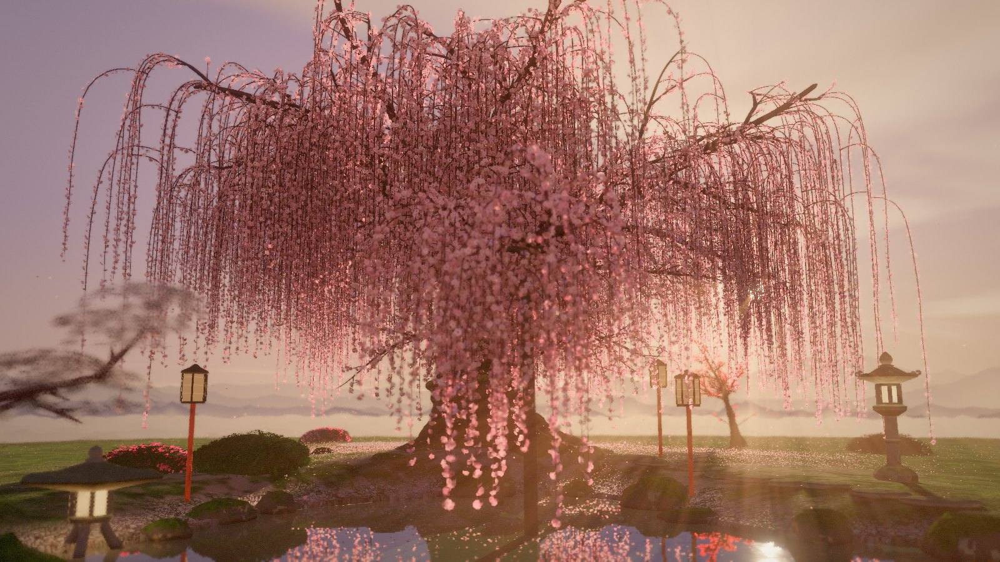
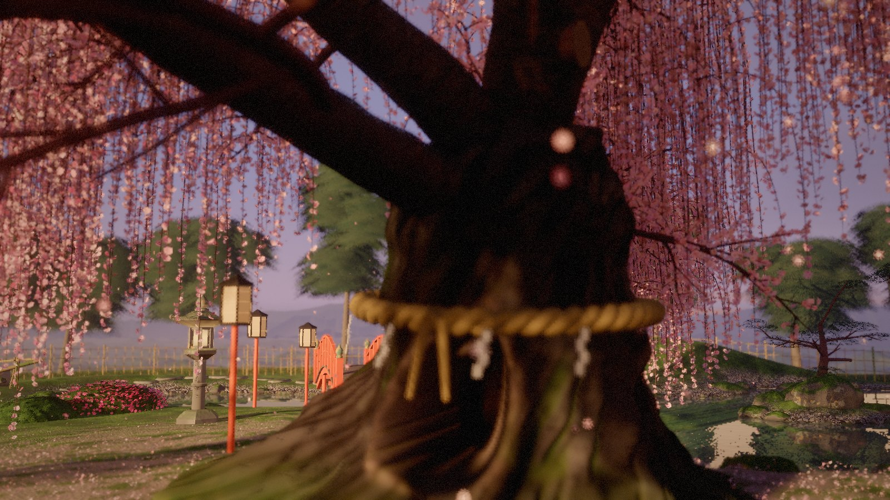
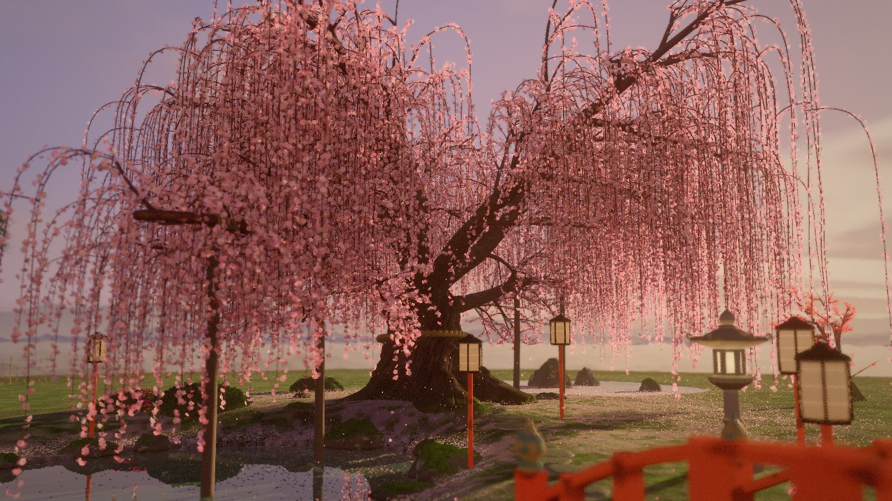
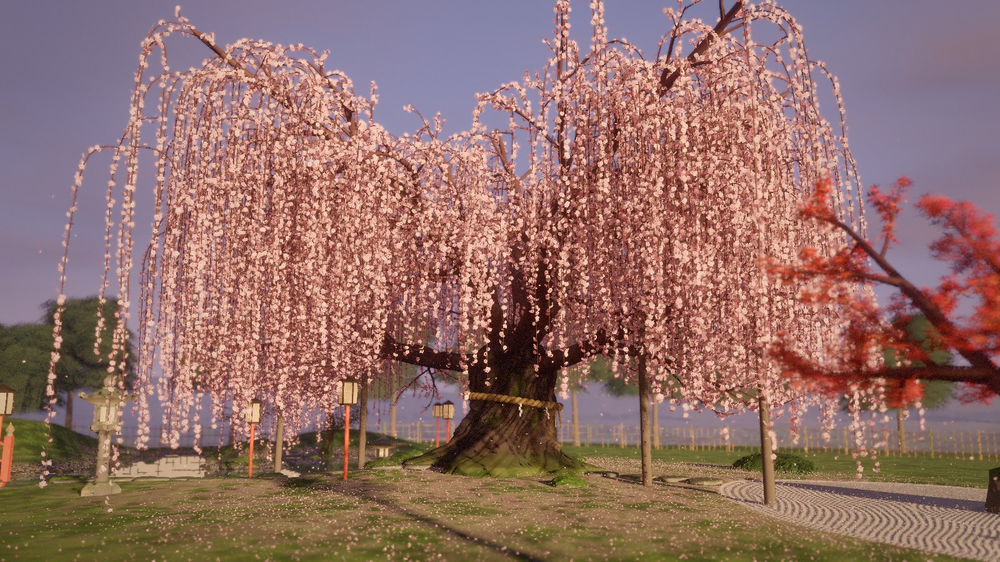

# Yūzakura · 夕桜

*Cherry blossoms at dusk.* An ancient weeping cherry (shidare-zakura) in full bloom,
standing in a Japanese garden at golden hour, grown and rendered in real time in the
browser. Curtains of blossom sway over a koi pond, petals drift down and float on the
water, lanterns glow, and the camera wanders slowly through the garden.



| | |
|---|---|
|  |  |
|  | |

## Running it

The scene is plain ES modules with no build step. Serve the folder with any static
server and open it in a browser with WebGL 2:

```sh
python3 -m http.server 8000
# then open http://localhost:8000
```

three.js (0.170.0) loads from jsDelivr through the import map in `index.html`. That is
the only dependency.

### Controls

| Input | Action |
|---|---|
| Drag | Look around the tree (the cinematic camera hands over to you) |
| Scroll / pinch | Move closer or further away |
| `C` or `Space` | Toggle the cinematic camera |
| `M` | Toggle the ambient sound (wind, plucked strings, the shishi-odoshi's knock) |
| `H` | Hide or show the interface |

The cinematic camera resumes on its own after a few quiet seconds. Its loop takes about
four minutes and passes through ten viewpoints, including one inside the blossom curtain
beside the trunk.

### URL options

| Parameter | Meaning |
|---|---|
| `?seed=23` | Grow a different tree. Every seed gives a new skeleton, crown and blossom layout |
| `?tree=yoshino` | The broad, non-weeping Somei-Yoshino cherry instead of the weeping one |
| `?quality=low\|medium\|high` | Override the automatic quality choice |

Quality is picked from the GPU class, and the render scale then adapts to hold a smooth
frame rate.

## Inspiration

The design follows real places and traditions:

- **The tree** takes after the ancient "waterfall cherries" such as Miharu Takizakura: a
  roughly 1,000-year-old weeping cherry whose many trunks have twisted together, with
  wooden posts holding up its heavy limbs. Old sacred trees are marked with a straw
  *shimenawa* rope and zigzag paper *shide*.
- **The garden** draws on stroll gardens like Rikugien and the Heian Shrine gardens,
  where weeping cherries lean over ponds and are lit in the evening. It borrows their
  irregular koi ponds with a rock island and pebble beaches, the vermilion arched bridge
  (*sori-bashi*), Kasuga and Yukimi stone lanterns, clipped azalea mounds (*karikomi*), a
  raked-gravel court, a stone wash-basin (*tsukubai*) with a *shishi-odoshi*, and the
  *bonbori* paper lamps of night cherry viewing.

## How it is made

Nothing in the scene comes from a stock primitive. Every mesh, texture pattern and
shader is generated by the code in `src/`.

**Trees** (`src/tree/skeleton.js`, `species.js`). One generator grows every tree from a
species description: trunk, scaffold limbs, then ever finer branch orders, steered by
wander noise, tropisms, a held compass heading and a crown envelope. Radii follow a pipe
model. The weeping cherry adds two long low limbs that rest on props, and about 2,000
pendulous branchlets that leave their parents in a fountain arc and hang in bundles
toward the ground and the water. The same generator grows the Japanese maple and the
cloud-pruned black pines.

**The ancient trunk** (`src/tree/barkMesh.js`, `barkMaterial.js`). Its cross-section is
the union of five offset circles that spiral around the axis, so it reads as several stems
fused and twisted together, with sharp creases between them. On top of that come
buttresses running into nine surface roots, burls, a rotted hollow with rolled callus
lips, and healed pruning stubs whose flat cut faces show growth rings. The bark shader
switches with the age of the wood: glossy banded skin on young shoots, horizontal plates
on mature limbs, and on the trunk deep furrows that follow the spiral grain, filled with
moss and spotted with lichen.

**Blossoms** (`src/tree/blossoms.js`, `blossomMaterial.js`). About 320,000 deep-pink
flowers hang in strings along the branchlets. Each has its own openness, tint, age and
shed petals. Near the camera they use a sculpted mesh with cupped petals, stamens,
pedicels and sepals; further away each flower is one card with the five notched petals
drawn from a signed distance field. Petals are lit as thin translucent sheets.

**The garden** (`src/garden/`). `layout.js` defines the plan once as distance functions
shared by JavaScript and GLSL: a three-lobed pond with an island, a raked-gravel court,
mossy hills and paths. `structures.js` builds the stone lanterns from their traditional
parts (base, shaft, platform, firebox, upturned roof, jewel), the bridge with its plank
deck and bronze *giboshi* finials, the limb props, the twisted two-ply rope with its knot
and *shide*, the fence, the wash-basin with its ladle and spout, the rocking bamboo tube,
the lamps, and fractured rocks and stepping stones. `vegetation.js` clothes azalea mounds
with leaf whorls and magenta flowers, the maple with palmate red leaves, the pines with
needle pads, and closes the back of the garden with evergreen woodland. The ground shader
paints velvet moss, rake patterns that ripple around the stones, pebble beaches and the
pond bed.

**The pond** (`water.js`, `koi.js`). The scene is re-rendered from a mirrored camera with
an oblique near plane for the reflection. The surface adds wind ripples, rings where
petals land, Fresnel and murky jade water. Petals that fall in float and drift. Nine koi
in traditional varieties (kohaku, sanke, showa, ogon, asagi) swim slow loops with an
undulating body and trailing fins, seen through the water.

**Light and air**. Low golden sun with PCSS-style soft shadows, a baked light volume
through the blossom canopy, eight flickering lantern lights shared by every material,
falling petals simulated from real flower positions, sunlit pollen, and a sky with clouds
and layered misty ridges. Post-processing is written from scratch: 4× MSAA HDR, bokeh
depth of field, light shafts, mip-chain bloom, AgX tone mapping and a gentle grade.

**Sound** (`src/audio/ambience.js`). Optional and generated in code: wind that swells
with the gusts, a rustle of blossoms, plucked strings in a Japanese *in* scale, and the
hollow knock of the shishi-odoshi each time it tips.

## Project layout

```
index.html            page, import map, overlay markup
src/main.js           boot sequence, quality tiers, frame loop
src/core/             seeded RNG, noise, vector helpers, mesh builder
src/tree/             tree generator, species, bark mesh and shader, blossoms, canopy light
src/garden/           garden plan, structures, prop shader, vegetation, pond, koi
src/world/            atmosphere, sky, terrain, grass, petals, motes, wind
src/render/           shared GLSL, uniforms, sun shadows, post-processing
src/camera/           cinematic camera loop and user controls
src/ui/               loader, title card and controls
src/audio/            synthesised ambience
docs/                 screenshots
```
